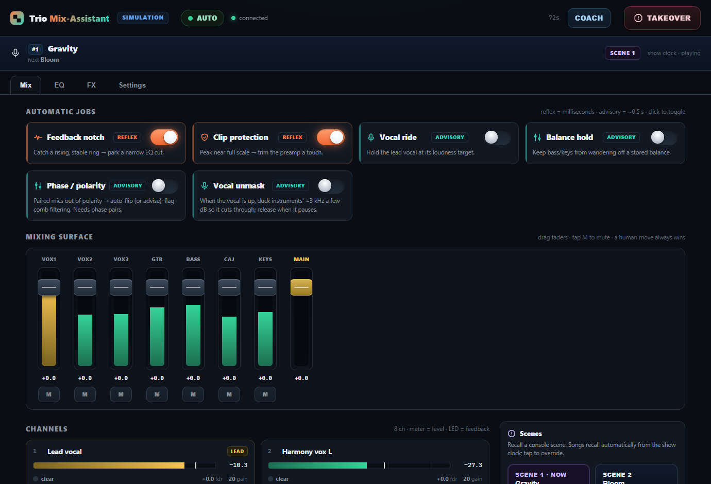
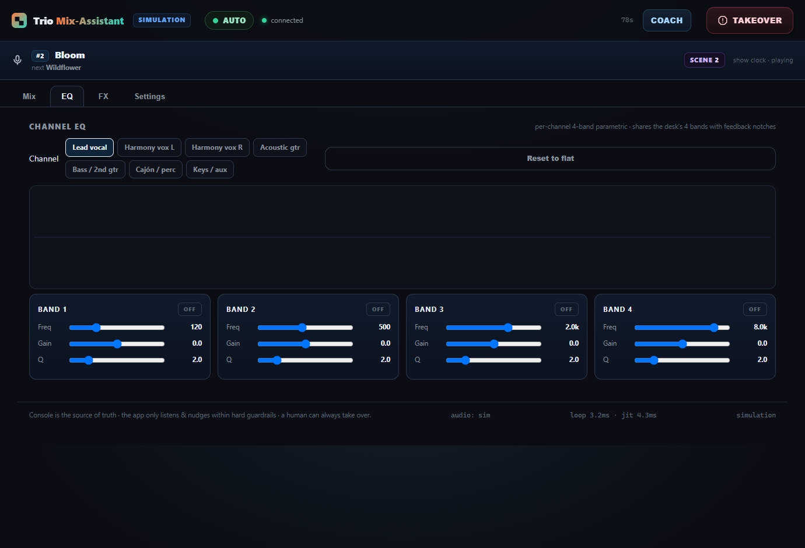
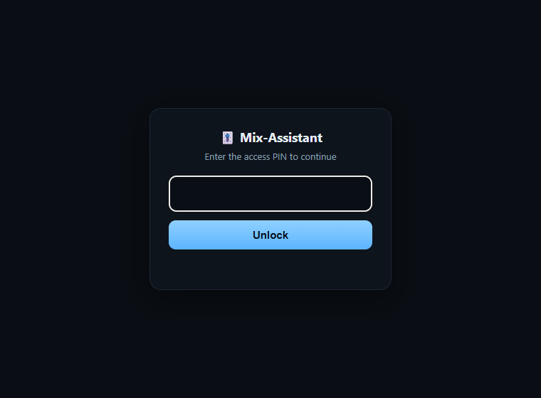

<div align="center">

# 🎚️ Trio Mix‑Assistant

### A live‑sound **safety net** + **operator dashboard** for a Midas M32C / Behringer X32 — for the gig with no sound engineer.

It *listens* to the band and the room, and gently *nudges* the console within hard guardrails. The console is always the source of truth, every move is logged and reversible, and **a human can take over instantly**. Runs and is fully testable **with no hardware at all**.

[Try it in 60 seconds](#-try-it-in-60-seconds) · [Requirements](#-requirements) · [Setup (PC & Mac)](#setup) · [Operating it](#operating-it) · [Mixing Station](#mixing-station) · [How it works](#-how-it-works)



</div>

---

## ✨ What it is

Small acoustic acts often play with **no one at front‑of‑house**. This app is the missing safety net: it watches the channels and a measurement mic and makes small, safe corrections — catch a feedback ring, pull back a clipping preamp, hold the lead vocal at a steady level — while **you** keep playing.

- **Deterministic real‑time core.** Feedback/clip/level decisions are plain DSP and clamped controllers — no machine learning, no black box — so behaviour is predictable and repeatable. (An *optional* Claude "slow layer" can post plain‑language advice — **advisory only, it never touches the mix**.)
- **Console stays in charge.** Move a fader on the desk or a tablet and the app yields. One **TAKEOVER** button hands everything back to a human.
- **Coach mode — you mix, it guides.** One toggle flips the app from *acting* to *advising*: it suspends **every** automatic move and instead tells you the exact manual change to make (channel, band, dB, Hz, even which scene to recall). Same deterministic math — just surfaced as instructions instead of applied. For hands‑on engineers, teaching, or previewing what it *would* do.
- **Runs with zero hardware.** A built‑in simulator and a protocol‑faithful console **emulator** let you learn, demo, and rehearse the whole rig on a laptop — and even mix on **real Mixing Station** against it (see below).
- **One dashboard, any screen.** A single installable web app (PWA) works identically on the FOH laptop, an iPad, or an Android tablet over WiFi.

## 📸 Screenshots

| Mix — jobs, faders, channels, decision log | EQ — per‑channel 4‑band PEQ |
|---|---|
| [](docs/screenshots/dashboard-full.png) |  |
| **FX — per‑channel sends + wet returns** | **Settings — status, performance, calibration** |
|  |  |

<div align="center">

**Tablet / phone (responsive PWA)** &nbsp;·&nbsp; [▶ See the full dashboard in one image](docs/screenshots/dashboard-full.png)


</div>

### 🎧 Coach mode — advise, don't act

Flip **COACH** and the app stops touching the console: every move it *would* make — feedback notch, clip trim, vocal ride, room calibration, even scene recall — is listed as a plain manual instruction in a **Coach — manual moves** panel (and the decision log) for you to dial in by hand. Same deterministic math; only your own moves act. **Tap the image for the full‑page view.**

[](docs/screenshots/coach-full.png)

## 🚀 Try it in 60 seconds

No console, no mic, no audio interface — pure **simulation**. A closed‑loop "stage" drives the assistant so you can watch feedback get notched, a clip get trimmed, and the vocal ride compensate, live.

**Windows**
```powershell
git clone https://github.com/kootru-repo/trio-mix-assistant.git
cd trio-mix-assistant\app
python -m pip install numpy
python run.py
```

**macOS**
```bash
git clone https://github.com/kootru-repo/trio-mix-assistant.git
cd trio-mix-assistant/app
python3 -m pip install numpy
python3 run.py
```

Then open **http://127.0.0.1:8770/** — toggle the jobs and watch the behaviour change.

> Prefer no terminal? See **[Setup](#setup)** for the double‑click installers (`setup.bat` / `setup.command`).

## 📋 Requirements

The app has three modes; each needs different things. **Simulation needs almost nothing.**

### Software

| | 🧪 Simulation | 🎛️ Emulation (rehearse the full rig) | 🎤 Production (live show) |
|---|---|---|---|
| **Python** | 3.10+ | 3.10+ | 3.10+ |
| **Packages** | `numpy` | `numpy`, `python-osc` (+ `sounddevice` for a real mic) | `numpy python-osc sounddevice cryptography qrcode` |
| **Install** | `pip install numpy` | one‑time `setup` | one‑time `setup` (bundles all of the above) |

### Hardware

| | 🧪 Simulation | 🎛️ Emulation | 🎤 Production |
|---|---|---|---|
| **Computer** | Any PC / Mac | Any PC / Mac | FOH laptop (Win/macOS) |
| **Console** | — | — (emulated) | **Midas M32C** or X32‑family, on the LAN |
| **Audio interface** | — | Optional (USB mic to test calibration/feedback) | Console USB/card feed **or** an interface (e.g. Focusrite Scarlett) |
| **Measurement mic** | — | Optional | **Yes** — a mic at FOH for room + feedback listening |
| **Network** | — | — | WiFi router/switch linking laptop ↔ console (↔ tablet) |
| **Tablet** | — | Optional | Optional — iPad / Android for a wireless dashboard |
| **AbleSet** | — | — | Optional — automatic scene recall from the setlist |

> 💡 **Don't have the console yet?** Use **Emulation** — it runs the *exact* production code against a built‑in M32C emulator over real network sockets. You can plug in a USB mic and run a real pink‑noise room calibration and feedback test. See [Operating it](#operating-it).

<a id="setup"></a>

## 🛠️ Setup

> Copy the `app/` folder to the FOH laptop (or run it from the clone). The one‑time setup builds a local Python environment so nothing else on the machine is touched.

### Windows
1. Install **Python 3.10+** from [python.org](https://www.python.org/downloads/) — tick **“Add Python to PATH”**.
2. In `app/`, double‑click **`setup.bat`** (one time).
3. Double‑click **`list-devices.bat`** and note your audio device number.
4. Open **`show.conf`** in Notepad → set `CONSOLE_IP` and `AUDIO_DEVICE` (or set `AUTO=yes` to auto‑detect).
5. Double‑click **`start.bat`** — the dashboard opens in your browser.

### macOS
1. Install **Python 3.10+** from [python.org](https://www.python.org/downloads/).
2. Open Terminal, `cd` into `app/`, then `bash setup.command` (one time).
3. `bash list-devices.command` and note your audio device number.
4. `open show.conf` → set `CONSOLE_IP` and `AUDIO_DEVICE` (or `AUTO=yes`), save.
5. `bash start.command`.
   - The first run, macOS asks for **Microphone** and **Network** permission — **allow both** (System Settings → Privacy & Security → Microphone), or capture stays silent.

> 🧪 **No hardware?** Double‑click **`rehearse.bat`** (Windows) / `bash rehearse.command` (macOS) to run the whole app against the built‑in emulator.
> 📱 **Use a tablet?** Keep `LAN=yes`/`HTTPS=yes` in `show.conf` (the defaults); the start window prints a **scan‑to‑open QR code** — see [Operating it → On a tablet](#operating-it) for the connect example.
> 📡 **Offline install:** on a same‑OS machine with internet, run `fetch-wheels` to fill a `wheels/` folder, copy the folder over, then `setup` installs with no internet.

<a id="operating-it"></a>

## 🎚️ Operating it

All commands run from the **`app/`** folder. The double‑click scripts above wrap these; the CLI gives full control.

### Run modes

| Mode | Command | What it does |
|---|---|---|
| **Simulation** | `python run.py` | Closed‑loop synthetic stage. Learn the UI, demo, no gear. |
| **Emulate (no console)** | `python run.py --emulate --lan` | Real production stack vs. a built‑in M32C emulator. |
| **Emulate + real mic** | `python run.py --emulate --lan --auto` | Same, but listens on your **real USB mic** — run a true room calibration & feedback test. |
| **Production** | `python run.py --hardware --console-ip 192.168.1.50 --auto --lan` | Drive the real M32C. `--auto` detects the mic; or use `--audio-device N`. |

Helpful flags: `--list-devices` (find audio inputs), `--lan` (serve to tablets + print a QR), `--https` (TLS, enables the tablet PWA + screen wake‑lock), `--pin "1234"` (require a PIN to open the dashboard + control the console — recommended on untrusted WiFi; pair with `--https`), `--template set.json` (per‑song scenes), `--venue "The Cellar"` (session log + learning), `--advisor` (optional Claude notes; needs `ANTHROPIC_API_KEY`).

### On the dashboard
- **AUTOMATIC JOBS** — toggle Feedback notch, Clip protection, Vocal ride, Balance hold.
- **MIXING SURFACE** — drag faders, tap **M** to mute; a human move makes auto‑ride yield on that channel.
- **Pink‑noise calibration** (Settings → *Run calibration*) — measures the room, parks gentle cuts on the worst peaks, and builds a feedback watch‑list. The result shows as an octave‑band chart with ▲ watch / ▼ cut chips.
- **Scenes** — recall console scenes; with a show template they recall automatically per song.
- **COACH** — flip the assistant from *acting* to *advising*: it stops touching the console and lists every move it would make (feedback notch, clip trim, vocal ride, calibration, even scene recall) as a plain manual instruction in a **Coach — manual moves** panel + the log, for you to dial in by hand. Only your own manual moves act.
- **TAKEOVER** — mutes the main and holds all jobs so a human always wins.
- **Deep links** — `…:8770/#eq`, `#fx`, `#settings` open straight to a tab (handy on a tablet).

### 📱 On a tablet (iPad / Android) — scan to connect

Run with `--lan --https`. At startup the terminal prints the dashboard's **LAN URL and a scan‑to‑open QR code** — point the tablet camera at it:


1. **FOH laptop:** `python run.py --emulate --lan --https` (or your production command). The start window prints the URL + QR (this is what `--lan` does; `--https` enables the PWA + wake‑lock).
2. **Tablet:** join the **same WiFi** as the laptop.
3. **Scan the QR** in the terminal with the tablet camera — or open the printed `https://<laptop‑ip>:8770/` URL.
4. Accept the **self‑signed certificate** warning once, then **Add to Home Screen** for a full‑screen app.

The QR at right is an *example* (`https://192.168.1.50:8770/`); yours encodes the laptop's real LAN IP. On Windows, click **Allow** on the first‑run **Firewall** prompt (the laptop must be on a *Private* network). Over plain `http` (no `--https`), Wake Lock no‑ops — set the tablet's auto‑lock to *Never* instead.

### 🔒 Locking it down (untrusted networks)

On a trusted FOH LAN the dashboard is open (no login). On shared/venue WiFi, add **`--pin "1234"`** (ideally with `--https`): the dashboard then asks for the PIN before it opens, and **every** control endpoint and the telemetry stream require it — so a stranger on the WiFi can't touch the console. The PIN is entered once per device (a `HttpOnly; SameSite=Strict` session cookie), with lockout after repeated wrong tries. The server also validates the `Host` header (DNS‑rebinding guard) regardless of the PIN.

**Zero cert warnings:** a self‑signed cert always shows a one‑time browser warning (it's encrypted but not *trusted*). To remove it completely, launch with **`--trust`**: the app runs a local root CA and serves a cert signed by it, then prints steps to install that root **once per device** (browse to `/ca.pem`, or copy `app/.certs/ca.pem`). After the one‑time install, every https connection is fully trusted — green padlock, no warning. (There's no server‑only way to skip the per‑device install; that's how certificate trust works. The alternative is plain http — no cert, no warning, but no PWA/Wake‑Lock and the PIN travels in clear.)



<a id="mixing-station"></a>

## 🎛️ Mixing Station — the operator's mixer surface

The **M32C has no faders or screen of its own** — it's a stage box, controlled entirely from a tablet or computer. **[Mixing Station](https://mixingstation.app)** is the mixer app this project is designed around (see [docs/ux-design.md](docs/ux-design.md)): the operator mixes on it while the assistant works underneath, and **any move you make in Mixing Station instantly wins** over the automation.

**The two‑surface setup:** Mixing Station = your hands (full mixer control) · the assistant's dashboard = its voice (what it's doing and why, COACH, TAKEOVER). Run them **split‑screen on one Android/iPad tablet**, or on two devices.

### Get it

| App | Platform | Download |
|---|---|---|
| **Mixing Station** | Android / iOS / Windows / macOS / Linux | [mixingstation.app](https://mixingstation.app) · [Google Play](https://play.google.com/store/apps/details?id=org.devcore.mixingstation) · App Store |

> In Mixing Station choose console type **Behringer X32** (the M32 speaks the same protocol) and access mode **Full**. It talks to the console over UDP **10023**.

### 🔌 Rehearse with NO console — connect Mixing Station to the emulator

The emulator answers Mixing Station's full discovery + sync + metering protocol, so you can rehearse the exact show‑day setup on a couch:

1. `python run.py --emulate --lan` on the laptop.
2. Phone/tablet on the same WiFi → Mixing Station → **Behringer X32** → the emulated desk appears as **MixAssist** in the search list (or enter the laptop's IP manually) → **Connect**, access **Full**.
3. It syncs the desk, live meters flow, and the **setlist's scenes appear in Mixing Station's scene list** (recall one — the app follows). The assistant's moves mirror live; your fader moves win instantly. Push test moves: `python osc_demo.py --animate`.

**Split screen on the operator's Android device** — the assistant's dashboard (top, song bar + COACH + TAKEOVER) and Mixing Station (bottom, the setlist's channels with live meters), both connected to the emulator at once:


This also **validates the OSC against a production mixer app** with no gear — set a fader to a known dB in the dashboard and confirm Mixing Station shows the same value (the fader law is verified this way).

> **Other editors:** Behringer **X32‑Edit** / Midas **M32‑Edit** (the official desktop editors) also connect to the emulator the same way — free fallback mirrors, same UDP 10023, same MixAssist discovery.

## 🧠 How it works

```
 mic + channels ─▶ DSP features ─▶ 4 guard‑railed jobs ─▶ clamp ─▶ Console (OSC)
   (listen)         (analyse)        (decide)            (safe)     (nudge)
                                          │
                          telemetry ──────┘──▶ dashboard (WebSocket / SSE)
```

| Job | Tier | Behaviour |
|---|---|---|
| **Feedback notch** | reflex | Catch a *rising*, *frequency‑stable* ring (sung notes are rejected) → park a narrow EQ cut. Calibration watch‑list freqs react a beat sooner. |
| **Clip protection** | reflex | Peak within ~1 dB of full scale → trim the preamp; creep it back once clean. |
| **Vocal ride** | advisory | Hold the lead vocal's *output* at a target as the singer's input drifts (deadband + step‑limit + smooth ramp). |
| **Balance hold** | advisory | Snapshot the bass/keys balance and hold it from wandering. |
| **Phase / polarity** | advisory | Cross‑correlate paired mics (mic + DI, two mics on one source): out of polarity → **auto‑flip** the channel Φ (or advise it in coach mode); flag comb‑filtering time offsets. Opt‑in via *phase pairs*. |
| **Vocal unmask** | advisory | Sidechained to the lead vocal: when it's present, **dynamically duck** each instrument's ~3 kHz band a few dB so the vocal cuts through, then release when it pauses (fast attack / slow release). Coach mode advises a static dip instead. |
| **Pink‑noise calibration** | pre‑show | Measure the room, cut the worst peaks, pre‑dip feedback‑prone freqs, seed the watch‑list. |

**Coach mode** turns this inside‑out: instead of acting, the app *advises*. One toggle suspends **every** automatic move — all the jobs above **plus** setlist scene recall and guest mutes — and surfaces the exact manual change to make (channel, band, dB, Hz, scene) in a Coach panel and the decision log. Same deterministic math, and the console is left untouched; only your own manual moves act. Use it to mix by hand with guidance, or to preview what the app would do before you trust a job.

Everything passes hard **guardrails** (fader/gain range, max step, smooth ramp); every move is **logged and reversible**. **259 automated tests** cover the OSC scaling, detection logic, the decision loops (auto *and* coach), the HTTP/WebSocket server, the hardware capture path, and a real‑socket round‑trip against the emulator.

## 📂 Project layout

```
trio-mix-assistant/
├── README.md                 ← you are here (overview + setup)
├── app/                      ← the application
│   ├── run.py                ← entry point (sim / emulate / hardware)
│   ├── osc_demo.py           ← push moves so Mixing Station mirrors the app
│   ├── trio_mix/             ← package: dsp, osc, assistant, engine, server…
│   ├── static/index.html     ← the single-file dashboard (no build step)
│   ├── tests/                ← 259 unit + integration tests
│   ├── setup/start/list-devices/rehearse  (.bat + .command)
│   ├── README.md             ← developer docs (architecture, internals)
│   ├── RUNBOOK.md            ← show-day guide (Windows & macOS)
│   └── HARDWARE_BRINGUP.md   ← one-time OSC validation against the real desk
└── docs/
    ├── screenshots/          ← the images above
    └── mix-assistant-design.html  ← design infographic
```

**Go deeper:** [app/README.md](app/README.md) (architecture & internals) · [app/RUNBOOK.md](app/RUNBOOK.md) (show‑day) · [app/HARDWARE_BRINGUP.md](app/HARDWARE_BRINGUP.md) (real‑desk validation).

## ✅ Tests

```bash
cd app
python -m unittest discover -s tests
```

## 📄 Owner

**the Trio Mix-Assistant authors**

## 📄 License & disclaimer

**Proprietary — © 2026 the Trio Mix-Assistant authors. All rights reserved.**
This software is private and **not licensed for use, copying, modification, or distribution**. No rights are granted without the owner's prior written consent — see **[LICENSE](LICENSE)**.

Not affiliated with or endorsed by Music Tribe, Behringer, or Midas. *X32‑Edit*, *M32‑Edit*, *X32*, and *M32* are trademarks of their respective owners — download their software only from the official links above. **OSC scalings vary across firmware; validate against your console before trusting it live** (see [HARDWARE_BRINGUP.md](app/HARDWARE_BRINGUP.md)).
