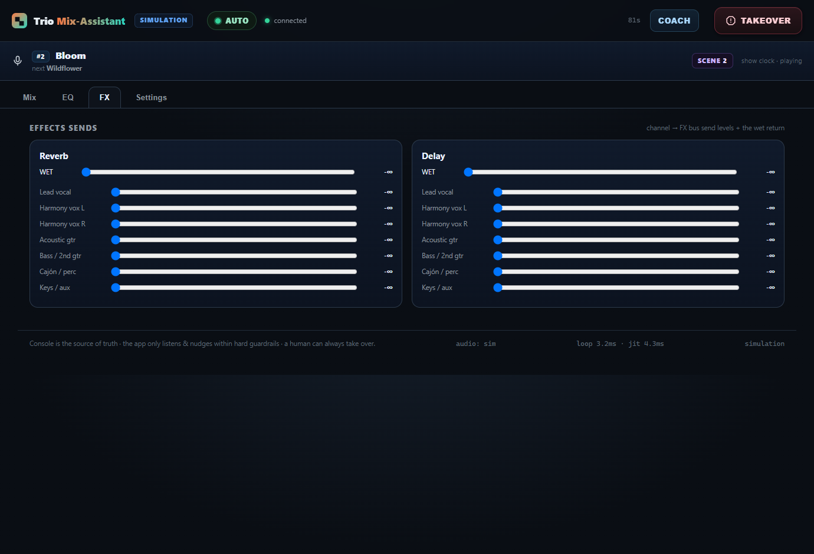
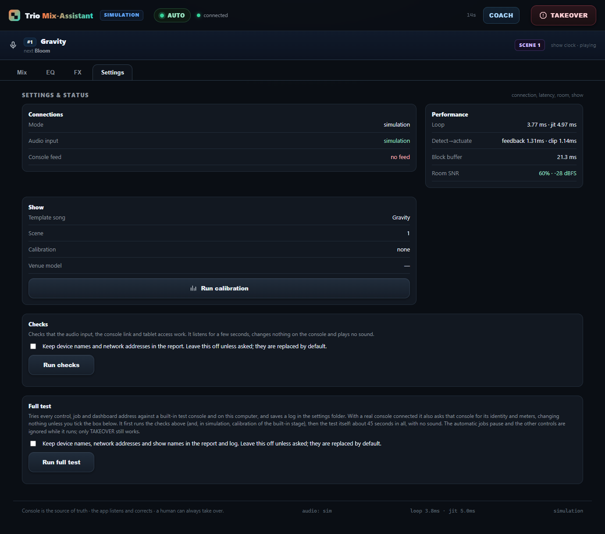
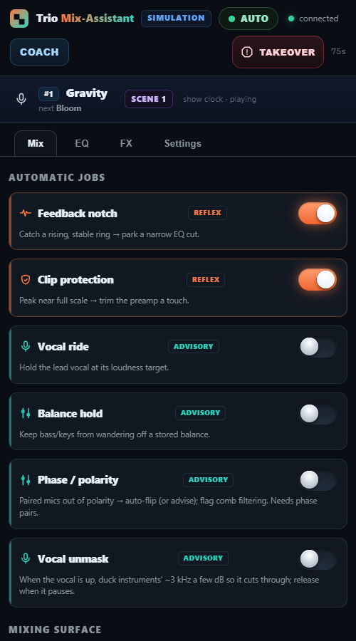
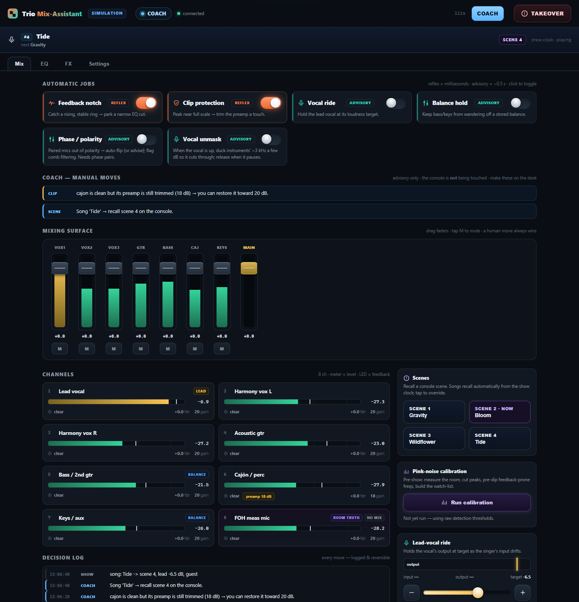
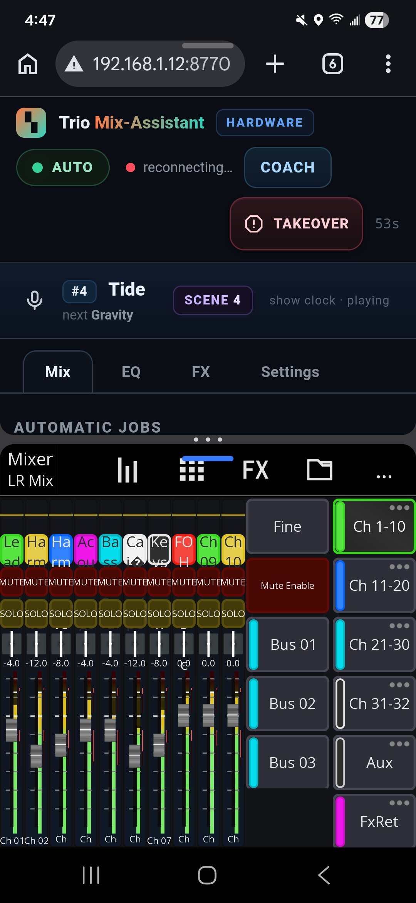

<div align="center">

# Trio Mix‑Assistant

**A live‑sound safety net and operator dashboard for a Midas M32C / Behringer X32, for the gig with no sound engineer.**

It *listens* to the band and the room, and gently *nudges* the console within hard guardrails. The console is always the source of truth, every move is logged and reversible, and a human can take over instantly. It runs, and is fully testable, with no hardware at all.

**[Download for Mac (Apple Silicon)](https://github.com/kootru-repo/trio-mix-assistant/releases/latest/download/TrioMixAssistant-macos-arm64.tar.gz)** · **[Mac (Intel)](https://github.com/kootru-repo/trio-mix-assistant/releases/latest/download/TrioMixAssistant-macos-x64.tar.gz)** · **[Windows](https://github.com/kootru-repo/trio-mix-assistant/releases/latest/download/TrioMixAssistant-windows-x64.zip)** · [All versions](https://github.com/kootru-repo/trio-mix-assistant/releases)

[Run it in a minute](#run-it) · [What has been tested](#tested) · [Set up for a show](#setup) · [Operating it](#operating-it) · [Mixing Station](#mixing-station) · [How it works](#how-it-works)


</div>

---

## What it is

Small acoustic acts often play with no one at front‑of‑house. This app watches the channels and a measurement mic and makes small, safe corrections while you keep playing: it catches a feedback ring, pulls back a clipping preamp, and holds the lead vocal at a steady level.

- **Deterministic real‑time core.** Feedback/clip/level decisions are plain DSP and clamped controllers with no machine learning, so behaviour is predictable and repeatable. (An optional Claude "slow layer" can post plain‑language advice. It is **advisory only** and never touches the mix.)
- **Console stays in charge.** Move a fader on the desk or a tablet and the app yields. One **TAKEOVER** button hands everything back to a human.
- **Coach mode: you mix, it guides.** One toggle flips the app from *acting* to *advising*. It suspends every automatic move and instead tells you the exact manual change to make (channel, band, dB, Hz, even which scene to recall). The deterministic math is the same; it is surfaced as instructions instead of applied. Use it for hands‑on engineering, for teaching, or to preview what the app would do.
- **Runs with zero hardware.** A built‑in simulator and a protocol‑faithful console emulator let you learn, demo, and rehearse the whole rig on a laptop. You can even mix on the real Mixing Station app against it (see below).
- **One dashboard, any screen.** A single installable web app (PWA) is built to work the same on a Mac or Windows laptop, an iPhone or iPad, or an Android device over WiFi.

## Screenshots

| Mix: jobs, faders, channels (click for the full page with the decision log) | EQ: per‑channel 4‑band PEQ |
|---|---|
| [](docs/screenshots/dashboard-full.png) |  |
| **FX: per‑channel sends + wet returns** | **Settings: connections, performance, show, checks** |
|  |  |

<div align="center">

**Tablet / phone (responsive PWA)** &nbsp;·&nbsp; [▶ See the full dashboard in one image](docs/screenshots/dashboard-full.png)



</div>

### Coach mode: advise, don't act

Flip **COACH** and the app stops touching the console. Every move it would make (feedback notch, clip trim, vocal ride, room calibration, even scene recall) is listed as a plain manual instruction in a **COACH — MANUAL MOVES** panel and the decision log, for you to dial in by hand. The deterministic math is the same; only your own moves act. Tap the image for the full‑page view.

[](docs/screenshots/coach-full.png)

<a id="run-it"></a>

## Run it in a minute

Nothing to install. The app carries everything it needs and starts in **simulation**, with no console, mic or audio interface. A closed-loop "stage" drives the assistant so you can watch feedback get notched, and a clip get trimmed, live. Turn on **Vocal ride** to watch it compensate too.

### Mac

1. Download the build for your Mac: **[Apple Silicon (M1 or later)](https://github.com/kootru-repo/trio-mix-assistant/releases/latest/download/TrioMixAssistant-macos-arm64.tar.gz)** or **[Intel](https://github.com/kootru-repo/trio-mix-assistant/releases/latest/download/TrioMixAssistant-macos-x64.tar.gz)**. Apple menu → **About This Mac** shows which you have.
2. Open **Terminal** and run (use the `x64` file name on an Intel Mac):
   ```bash
   mkdir -p ~/TrioMix && cd ~/TrioMix
   tar -xzf ~/Downloads/TrioMixAssistant-macos-arm64.tar.gz
   ./TrioMixAssistant
   ```
   If macOS refuses to open it, go to System Settings → Privacy & Security, click **Open Anyway**, and run the last line again.
3. The dashboard opens in your browser (the address is also printed). The browser warns once about the app's self-signed certificate: choose to proceed. Toggle the jobs and watch the behaviour change. Press Ctrl+C in Terminal to stop.
4. **Test your microphone (optional, 10 seconds).** Run `./TrioMixAssistant --list-devices` and note your microphone's number, then run `./TrioMixAssistant --diagnose --audio-device <number>`. Click **Allow** if macOS asks to let Terminal use the microphone. It listens for eight seconds, plays no sound, and prints what passed. Nobody has confirmed listening on a Mac yet, so please paste the report (from the `=====` line down) into an [issue](https://github.com/kootru-repo/trio-mix-assistant/issues), pass or fail.

### Windows

1. Download **[TrioMixAssistant-windows-x64.zip](https://github.com/kootru-repo/trio-mix-assistant/releases/latest/download/TrioMixAssistant-windows-x64.zip)** and unzip it.
2. Double-click **`TrioMixAssistant.exe`**. Windows warns that the app is unsigned: choose **More info**, then **Run anyway**.
3. The dashboard opens in your browser. The browser warns once about the app's self-signed certificate: choose **Advanced**, then proceed. Toggle the jobs and watch the behaviour change.

### iPhone, iPad or Android

The app runs on the laptop; a phone or tablet on the same WiFi opens its dashboard in a browser. See [On a phone or tablet](#phone).

> All downloads and checksums are on the [releases page](https://github.com/kootru-repo/trio-mix-assistant/releases/latest). Developers can run from source instead: see [Run from source](#from-source).

<a id="tested"></a>

## What has been tested

| | Status |
|---|---|
| **Simulation and the built-in console emulator** | Tested automatically on macOS, Windows and Linux on every change. |
| **Listening on a Mac** | **Not tried yet.** Both Mac builds start, serve the dashboard and list devices on test computers with no audio hardware. |
| **Dashboard on an iPhone or iPad** | **Not tried yet** on a real device. |
| **Listening on Windows** | Run on real one- and two-channel inputs, including a nine-minute run with no dropped audio. The built-in checks ran there too. |
| **Console USB audio** (M32 / X32 multichannel feed) | **Not tried yet** on any system. |
| **Console control over the network** | Tested against the built-in emulator. Check it against your own console first: [bring-up checklist](app/HARDWARE_BRINGUP.md). |
| **Mixer apps against the emulator** | Mixing Station (on Android) and X32-Edit connected to the built-in emulator and synced; fader levels sent by the app showed the same dB in X32-Edit. M32-Edit has not been tried. |

Rehearse with your own gear before relying on it at a show. The apps are not signed by a registered developer (so macOS and Windows warn on first run), and on Windows there is no ASIO support (pick the **WASAPI** entry for your device).

## Requirements

The app has three modes, and each needs different things. Simulation needs only the download.

### Hardware

| | Simulation | Emulation | Production |
|---|---|---|---|
| **Computer** | Any Mac / PC | Any Mac / PC | FOH laptop (macOS / Windows) |
| **Console** | n/a | Emulated | **Midas M32C** or X32‑family, on the LAN |
| **Audio interface** | n/a | Optional (USB mic to test calibration/feedback) | Console USB/card feed or an interface (e.g. Focusrite Scarlett) |
| **Measurement mic** | n/a | Optional | **Yes**: a mic at FOH for room + feedback listening |
| **Network** | n/a | n/a (WiFi only if you add a phone or tablet) | Wired Ethernet between laptop and console (recommended; a dedicated WiFi access point can be used). WiFi for a phone or tablet |
| **Phone or tablet** | n/a | Optional | Optional: iPhone, iPad or Android for a wireless dashboard |
| **AbleSet** | n/a | n/a | Optional: automatic scene recall from the setlist |

> **Without the console:** use **Emulation**. It runs the *exact* production code against a built‑in M32C emulator over real network sockets. You can plug in a USB mic and run a real pink‑noise room calibration and feedback test. See [Operating it](#operating-it).

<a id="setup"></a>

## Set up for a show

These steps use the downloaded app. Wherever a step says `TrioMixAssistant`, type `./TrioMixAssistant` in a Mac Terminal or `.\TrioMixAssistant.exe` in a Windows terminal, opened in the folder that holds the app (on a Mac, `cd ~/TrioMix`).

1. **Find your audio input.** Plug in the console's USB cable or your interface, run `TrioMixAssistant --list-devices`, and note the device number. It needs enough inputs at 48000 Hz.
2. **Open the settings file.** The app creates `show.conf` on its first run and prints the folder at every start:
   - Mac: `~/Library/Application Support/TrioMixAssistant/show.conf`
   - Windows: `%LOCALAPPDATA%\TrioMixAssistant\show.conf`
3. **Set** `MODE=hardware`, `CONSOLE_IP` and `AUDIO_DEVICE` (the number from step 1). With a small interface or a single USB mic, `AUTO=yes` picks the input for you instead; leave it off with the console's 32-input USB feed, where it would pick the wrong channel for the measurement mic. For a phone or tablet, set `LAN=yes` and a `PIN` of six or more characters.
4. **Start the app** the same way as before. On a Mac, click **Allow** when macOS asks to let Terminal use the microphone and the network, or the app hears silence.

### Check your setup

The app can check itself. With a real input or a console to check, it listens for about eight seconds; it **changes nothing on the console and plays no sound**, then lists what passed, what failed and how to fix it.

- **In the dashboard:** Settings → **Run checks**. Use this while the app is running.
- **In a terminal:** `TrioMixAssistant --diagnose` checks the setup in `show.conf` without starting the show. To check just one input, with no console: `TrioMixAssistant --diagnose --audio-device <number>`.

It checks that the audio module loads, the chosen input opens at 48000 Hz, audio arrives without gaps, the signal is not blocked by the system's microphone permission, each channel shows a level, the console answers, and tablet access is protected by a PIN. It cannot prove the console's control formats are right; that is still the [bring-up checklist](app/HARDWARE_BRINGUP.md).

The report can be copied. If something fails on your gear, or you got a Mac or a console's USB feed working, please paste the report into an [issue](https://github.com/kootru-repo/trio-mix-assistant/issues): those are the setups nobody has confirmed yet. It never contains the PIN, and the path of your home folder is removed. From a terminal, copy from the `===== Trio Mix-Assistant checks =====` line down: the first line the app prints shows your settings folder.

> **No console yet:** run `TrioMixAssistant --emulate` to rehearse the whole app against the built-in console emulator. Add `--auto` to listen on a real mic.
>
> **iPhone, iPad or Android:** with `LAN=yes` and a `PIN`, the start window prints a **scan-to-open QR code**. See [On a phone or tablet](#phone).
>
> **Show day:** the full guide is the [runbook](app/RUNBOOK.md).

<a id="from-source"></a>

<details>
<summary><b>Run from source</b> (for developers; needs Node.js 22.13+)</summary>

The app is written in TypeScript and has no runtime dependencies. Get the code (**Code → Download ZIP**, or `git clone`), open a terminal in its folder, then:

```bash
cd app/ts
npm install
npm run run
```

Open **http://127.0.0.1:8770/**.

- **Live listening** goes through an optional native module, `naudiodon2`, which `npm install` compiles when a C++ compiler is present. Without it the app still runs in simulation and emulation, and for manual mixing and scene recall.
- **Double-click folder:** `npm run package` writes `app/ts/dist/package/TrioMixAssistant.zip`, a zipped folder with `start`, `rehearse` and `list-devices` scripts and its own `show.conf`. It needs Node.js on the computer and does not carry the audio module. `START-HERE.txt` inside it has the steps.
- **Build the single-file app yourself:** `npm run exe`. Details are in the [app README](app/README.md#single-file-app-no-nodejs-install).

</details>

<a id="operating-it"></a>

## Operating it

The commands below are for the downloaded app on a Mac. On Windows, type `.\TrioMixAssistant.exe` in place of `./TrioMixAssistant`.

Started with no flags, the app uses `show.conf` (simulation until you change it). Started with flags, it ignores `show.conf`, so put everything on the command line; `--diagnose` on its own still reads `show.conf`. From source, in the **`app/ts`** folder, `npm start` is the no-flag form and `npm run run --` takes the flags.

### Run modes

| Mode | Command | What it does |
|---|---|---|
| **Simulation** | `./TrioMixAssistant` | Closed‑loop synthetic stage. Learn the UI, demo, no gear. |
| **Emulate (no console)** | `./TrioMixAssistant --emulate --lan --https --pin 123456` | Real production stack vs. a built‑in M32C emulator. |
| **Emulate + real mic** | `./TrioMixAssistant --emulate --lan --https --pin 123456 --auto` | Same, but listens on your real USB mic, so you can run a true room calibration & feedback test. |
| **Production** | `./TrioMixAssistant --hardware --console-ip 192.168.1.50 --audio-device <number> --lan --https --pin 123456` | Drive the real M32C. `<number>` comes from `--list-devices`; with a small interface, `--auto` picks the input instead. |

Helpful flags: `--list-devices` (find audio inputs), `--lan` (serve to tablets + print a QR), `--https` (TLS, enables the tablet PWA + screen wake‑lock), `--pin "123456"` (a PIN of at least 6 characters to open the dashboard + control the console; required whenever the dashboard is served to the network, paired with `--https`; `--insecure-open` allows an open dashboard), `--template set.json` (per‑song scenes), `--venue "The Cellar"` (session log + learning), `--advisor` (optional Claude notes; needs `ANTHROPIC_API_KEY`).

### On the dashboard
- **AUTOMATIC JOBS**: toggle Feedback notch, Clip protection, Vocal ride, Balance hold, Phase / polarity and Vocal unmask. Feedback notch and Clip protection are on at start.
- **MIXING SURFACE**: drag faders, tap **M** to mute; a human move makes auto‑ride yield on that channel.
- **Pink‑noise calibration** (Settings → *Run calibration*) measures the room, parks gentle cuts on the worst peaks, and builds a feedback watch‑list. The result shows as an octave‑band chart with ▲ watch / ▼ cut chips.
- **Scenes**: recall console scenes; each song in the setlist recalls its scene automatically (on a real console this also needs AbleSet, `--ableset-port`).
- **COACH**: flips the assistant from *acting* to *advising*. It stops touching the console and lists every move it would make (feedback notch, clip trim, vocal ride, calibration, even scene recall) as a plain manual instruction in a **COACH — MANUAL MOVES** panel + the log, for you to dial in by hand. Only your own manual moves act.
- **TAKEOVER**: mutes the main and holds all jobs so a human always wins.
- **Deep links**: `…:8770/#eq`, `#fx`, `#settings` open straight to a tab (handy on a tablet).

<a id="phone"></a>

### On a phone or tablet (iPhone, iPad, Android): scan to connect

Run with `--lan --https --pin <PIN>`. At startup the terminal prints the dashboard's **LAN URL and a scan‑to‑open QR code**. Point the phone or tablet camera at it:


1. **FOH laptop:** `./TrioMixAssistant --emulate --lan --pin 123456 --https` on a Mac, `.\TrioMixAssistant.exe` with the same flags on Windows (or your production command). The start window prints the URL + QR (this is what `--lan` does; `--https` enables the PWA + wake‑lock).
2. **Phone or tablet:** join the **same WiFi** as the laptop.
3. **Scan the QR** in the terminal with the camera, or open the printed `https://<laptop-ip>:8770/` URL.
4. Accept the **self‑signed certificate** warning once, then **Add to Home Screen** for a full‑screen app. On an iPhone or iPad, open it in Safari and use **Share → Add to Home Screen**; on Android, use the Chrome menu.

The QR at right is an *example* (`https://192.168.1.50:8770/`); yours encodes the laptop's real LAN IP. On a Mac, click **Allow** when macOS asks to let the app accept incoming network connections. On Windows, click **Allow** on the first‑run **Firewall** prompt (the laptop must be on a *Private* network). Over plain `http` (no `--https`), Wake Lock no‑ops, so set the device's auto‑lock to *Never* instead.

### Locking it down (untrusted networks)

Serving the dashboard to the network (`--lan`) needs a PIN of at least 6 characters, and the app refuses to start without one unless you pass **`--insecure-open`** (or `ALLOW_OPEN=yes` in `show.conf`) on a network you fully trust. Set **`PIN=123456`** in `show.conf` or add **`--pin "123456"`** (ideally with `--https`): the dashboard then asks for the PIN before it opens, and every control endpoint and the telemetry stream require it, so a stranger on the WiFi can't touch the console. The PIN is entered once per device for each run of the app (a `HttpOnly; SameSite=Strict` session cookie). Five wrong tries lock out only the device that made them for 30 seconds, doubling on each repeat up to 15 minutes, and devices already signed in keep control throughout. Across all devices, unsuccessful sign-in attempts are capped at 20 to 30 a minute; past the cap, devices that have not signed in before are refused until the minute passes. With or without a PIN, the server validates the `Host` header (DNS‑rebinding guard) and refuses control requests and WebSocket connections that come from another website (`Origin` check), so a page open in the operator's browser cannot drive the console.

**Zero cert warnings:** a self‑signed cert always shows a one‑time browser warning (it's encrypted but not *trusted*). To remove it completely, set **`TRUST=yes`** in `show.conf` (or add **`--trust`** to your command line): the app runs a local root CA and serves a cert signed by it, then prints steps to install that root **once per device** (browse to `/ca.pem`, or copy `ca.pem` from the `.certs` folder beside `show.conf`). After the one‑time install, every https connection is fully trusted: green padlock, no warning. (There's no server‑only way to skip the per‑device install; that's how certificate trust works. The alternative is plain http, with no cert and no warning, but also no PWA/Wake‑Lock, and the PIN travels in clear.)


<a id="mixing-station"></a>

## Mixing Station: the operator's mixer surface

The M32C has no faders or screen of its own. It is a stage box, controlled entirely from a tablet or computer. **[Mixing Station](https://mixingstation.app)** is the mixer app this project is designed around (see [docs/ux-design.md](docs/ux-design.md)): the operator mixes on it while the assistant works underneath, and any move you make in Mixing Station instantly wins over the automation.

**The two‑surface setup:** Mixing Station = your hands (full mixer control) · the assistant's dashboard = its voice (what it's doing and why, COACH, TAKEOVER). Run them split‑screen on one iPad or Android tablet, or on two devices (for example an iPhone and the laptop).

### Get it

| App | Platform | Download |
|---|---|---|
| **Mixing Station** | iOS / macOS / Android / Windows / Linux | [mixingstation.app](https://mixingstation.app) · App Store (search "Mixing Station") · [Google Play](https://play.google.com/store/apps/details?id=org.devcore.mixingstation) |

> In Mixing Station choose console type **Behringer X32** (the M32 speaks the same protocol) and access mode **Full**. It talks to the console over UDP **10023**.

### Rehearse with no console: connect Mixing Station to the emulator

The emulator answers Mixing Station's full discovery + sync + metering protocol, so you can rehearse the exact show‑day setup on a couch:

1. `./TrioMixAssistant --emulate --lan --https --pin 123456` on the laptop (`.\TrioMixAssistant.exe` on Windows).
2. Phone/tablet on the same WiFi → Mixing Station → **Behringer X32** → the emulated desk appears as **MixAssist** in the search list (or enter the laptop's IP manually) → **Connect**, access **Full**.
3. It syncs the desk, live meters flow, and the setlist's scenes appear in Mixing Station's scene list. The assistant's moves mirror live; your fader moves win instantly. From source you can push test moves: `npm run osc-demo -- --animate` in `app/ts`.

**Split screen on one Android device** during an emulator session: the assistant's dashboard (top) and Mixing Station (bottom, the trio's channels with live meters):



This also validates the OSC against a production mixer app with no gear. Set a fader to a known dB in the dashboard and confirm Mixing Station shows the same value (the fader law was checked this way against X32-Edit).

> **Other editors:** Behringer **X32‑Edit** / Midas **M32‑Edit** (the official desktop editors) also connect to the emulator the same way. They are free fallback mirrors on the same UDP 10023, with the same MixAssist discovery. Only X32-Edit has been tried.

## How it works

```
 mic + channels ─▶ DSP features ─▶ 6 guard‑railed jobs ─▶ clamp ─▶ Console (OSC)
   (listen)         (analyse)        (decide)            (safe)     (nudge)
                                          │
                          telemetry ──────┘──▶ dashboard (WebSocket / SSE)
```

| Job | Tier | Behaviour |
|---|---|---|
| **Feedback notch** | reflex | Catch a *rising*, *frequency‑stable* ring (sung notes are rejected) → park a narrow EQ cut. Calibration watch‑list freqs react a beat sooner. |
| **Clip protection** | reflex | Peak within ~1 dB of full scale → trim the preamp; creep it back once clean. |
| **Vocal ride** | advisory | Hold the lead vocal's *output* at a target as the singer's input drifts (deadband + step‑limit + smooth ramp). |
| **Balance hold** | advisory | Snapshot the bass/keys balance and hold it from wandering. |
| **Phase / polarity** | advisory | Cross‑correlate paired mics (mic + DI, two mics on one source): out of polarity → **auto‑flip** the channel Φ (or advise it in coach mode); flag comb‑filtering time offsets. Opt‑in via *phase pairs*. |
| **Vocal unmask** | advisory | Sidechained to the lead vocal: when it's present, **dynamically duck** each instrument's ~3 kHz band a few dB so the vocal cuts through, then release when it pauses (fast attack / slow release). Coach mode advises a static dip instead. |
| **Pink‑noise calibration** | pre‑show | Measure the room, cut up to four octave bands that stand out (a fifth or sixth gets a small dip), seed the watch-list. |

**Coach mode** turns this inside‑out: instead of acting, the app *advises*. One toggle suspends every automatic move, covering all the jobs above plus setlist scene recall and guest mutes, and surfaces the exact manual change to make (channel, band, dB, Hz, scene) in a Coach panel and the decision log. The math is the same deterministic math and the console is left untouched; only your own manual moves act. Use it to mix by hand with guidance, or to preview what the app would do before you trust a job.

Everything passes hard **guardrails** (fader/gain range, max step, smooth ramp); every move is logged and reversible. Automated tests cover the OSC scaling, detection logic, the decision loops (auto *and* coach), the HTTP/WebSocket server, the hardware capture path, and a real‑socket round‑trip against the emulator.

## Project layout

```
trio-mix-assistant/
├── README.md                 ← you are here (overview + setup)
├── app/                      ← the application
│   ├── ts/                   ← the application: core (no platform APIs), host, tests, fixtures
│   ├── static/               ← dashboard page + compiled JS (committed)
│   ├── web/                  ← TypeScript source for the dashboard (npm run build)
│   ├── show.conf             ← default settings (copied to the per-user folder on first run)
│   ├── templates/            ← example show templates (songs, scenes, channel maps)
│   ├── x32_default_nodes.scn ← the emulated desk's parameter tree
│   ├── START-HERE.txt        ← quick start shipped in the package
│   ├── README.md             ← developer docs (architecture, internals)
│   ├── RUNBOOK.md            ← show-day guide (macOS & Windows)
│   ├── HARDWARE_SETUP.md     ← what to buy and how to wire the listening rig
│   └── HARDWARE_BRINGUP.md   ← one-time OSC validation against the real desk
└── docs/
    ├── screenshots/          ← the images above
    ├── feedback-board.html   ← open in a browser to see musicians' feedback
    ├── ux-design.md          ← operator and performer experience design
    └── mix-assistant-design.html  ← design infographic
```

**Go deeper:** [app/README.md](app/README.md) (architecture & internals) · [app/RUNBOOK.md](app/RUNBOOK.md) (show‑day) · [app/HARDWARE_BRINGUP.md](app/HARDWARE_BRINGUP.md) (real‑desk validation).

## Tests

```bash
cd app/ts
npm install
npm run check      # type-check; src/core must stay free of platform APIs
npm test           # run directly by Node
```

CI (`.github/workflows/ci.yml`) runs the same two commands, and builds the dashboard to check the committed JavaScript matches its TypeScript source. On macOS it also builds the single-file app for Apple Silicon and Intel. The recorded fixtures the tests compare against are in `app/ts/fixtures`.

## Credits

- **Concept and requirements:** Chris Beulow and Eric Craton. The idea is theirs, and the tool is built to their requirements for playing a real stage with no sound engineer.
- **Programming:** Andrew Craton.

See **[AUTHORS.md](AUTHORS.md)**. To cite the project, use **[CITATION.cff](CITATION.cff)** (GitHub shows it as *Cite this repository*).

## Contributing

This is a community project and musicians' feedback is as welcome as code. See **[CONTRIBUTING.md](CONTRIBUTING.md)**, or open an issue and pick *Preference*, *Flow* or *UI suggestion*. Download **[docs/feedback-board.html](docs/feedback-board.html)**, open it in a browser, type `kootru-repo/trio-mix-assistant` in the box and press **Load**. It shows the open feedback in those three columns (under **Show**, choose *All* to include finished items).

## License & disclaimer

Copyright © 2026 the Trio Mix-Assistant authors (see [AUTHORS.md](AUTHORS.md)).

Released under the **[GNU Affero General Public License v3.0](LICENSE)** (AGPL-3.0). You may use it for anything, including paid gigs, and you may copy, change and share it. If you share a changed version, or run one for other people over a network, you must make your source available under the same license. It comes with no warranty.

Not affiliated with or endorsed by Music Tribe, Behringer, or Midas. *X32‑Edit*, *M32‑Edit*, *X32*, and *M32* are trademarks of their respective owners. Download their software only from Behringer's and Midas's own websites. **OSC scalings vary across firmware; validate against your console before trusting it live** (see [HARDWARE_BRINGUP.md](app/HARDWARE_BRINGUP.md)). *Mixing Station* is a product of dev-core.org.
