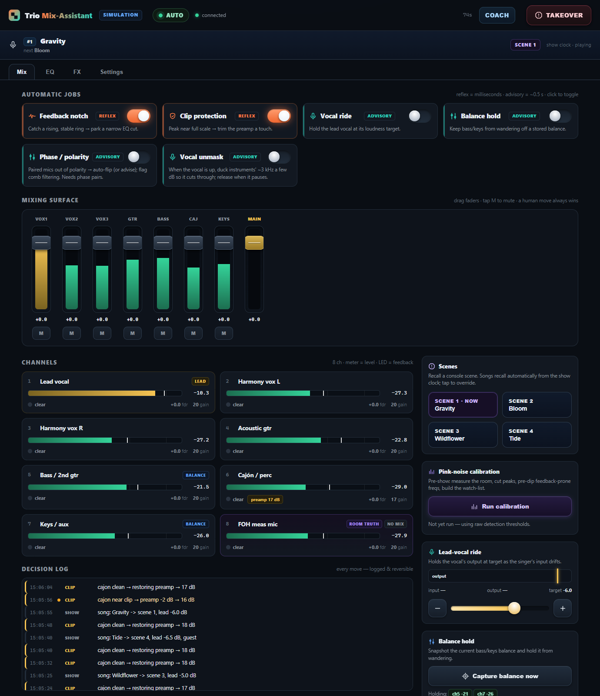

# Acoustic Trio Mix-Assistant

A deliberately small **safety-net** for a small acoustic-trio gig with no sound
engineer. It *listens* to the channels + a FOH measurement mic and *nudges* a
Midas M32C (X32/M32 OSC family) within hard guardrails. It ships with a live
**operator dashboard** and a **closed-loop simulator**, so the whole thing runs
and is testable without any hardware.

The real-time control path is deterministic, with no ML and no LLM. It uses
calibration-derived priors, a multi-guard feedback detector, and clamped
output-levelers. The one exception is an optional, latency-tolerant Claude
"slow layer" that can suggest plain-language notes for the band/operator. It is
*advisory only* and **never touches the mix**. That fast/slow split is the core
safety boundary.

Beyond the safety net it implements the AutoFOH show-side features:
- **AbleSet show clock → automatic scene recall** with per-song reference levels;
- a **performer dashboard** with Mix, **EQ** (per-channel 4-band PEQ with a live
  curve), **FX** (per-channel sends + wet returns) and **Settings** (status)
  screens, an AUTO/ALERT/MANUAL headline, and a **4-level notification hierarchy**
  (silent → log → banner → full-screen acknowledged overlay) with an **8-bar
  opening gate**;
- **template-driven channel maps** (the 8-ch trio *or* a 13-input rig from one JSON),
  guest mode, and stereo links;
- **venue learning**: post-show analysis writes a per-venue model (recurring
  feedback freqs + confidence) that pre-seeds the watch-list next time;
- **detect→actuate latency** + **room-mic SNR confidence** instrumentation.

See the repo **[README](../README.md)** (overview, screenshots, setup), the
**[design infographic](../docs/mix-assistant-design.html)**, **`HARDWARE_SETUP.md`**
(optimal listening rig + system requirements: what to buy & how to wire it),
**`RUNBOOK.md`** (show-day guide, Windows & macOS) and **`HARDWARE_BRINGUP.md`**
(one-time OSC-validation checklist).



## Quick start

```bash
cd ts
npm install                  # only to build and test; the app has no runtime dependencies
npm run run                  # simulation mode (no hardware)
# open http://127.0.0.1:8770/
```

In simulation a closed-loop "stage" drives the assistant: a feedback ring grows
until it's notched, a cajón transient overloads until the preamp is trimmed
(then recovers), and the lead vocal's input drifts so the ride visibly
compensates. Toggle the jobs and watch the behaviour change.

### Single-file app (no Node.js install)

Ready-made builds for Windows, Apple Silicon Macs and Intel Macs are on the
[releases page](https://github.com/kootru-repo/trio-mix-assistant/releases/latest). On Windows, unzip `TrioMixAssistant-windows-x64.zip`
and double-click `TrioMixAssistant.exe`. The Mac steps are under "On a Mac"
below. To build it yourself:

```bash
cd ts
npm install
npm run exe                  # writes dist/exe/TrioMixAssistant.exe (TrioMixAssistant on a Mac) and NODE-LICENSE.txt
```

The executable carries the Node.js runtime and the whole app, so the computer
that runs it needs nothing installed. Double-click it to start from `show.conf`
and open the dashboard, or pass the same flags as `npm run run --`
(`TrioMixAssistant.exe --emulate --lan --pin <pin>`).

- **Settings and logs** (`show.conf`, `sessions.db`, `.certs`, `venues`) live in
  `%LOCALAPPDATA%\TrioMixAssistant`. The folder is printed at start. To keep
  them beside the executable instead, put a `show.conf` next to it.
- **Live listening is inside.** The build packs the native audio binding
  (from `naudiodon2`, with PortAudio) and stops with an error if it is missing or does
  not load, so `npm install` on the build computer needs a C++ compiler. It has
  captured from one- and two-channel Windows inputs; a console's multichannel
  USB feed has not been tried yet. The module offers MME, DirectSound, WASAPI
  and WDM-KS devices, not ASIO. Run `TrioMixAssistant.exe --list-devices` with
  the console plugged in and look for an entry with enough inputs at 48000 Hz.
  Pick the **WASAPI** entry. In testing a WDM-KS entry stalled every few
  minutes (the app reopened it each time) and WASAPI did not stall at all.
- **It is unsigned,** so Windows shows a SmartScreen warning on first run.
- **The Node.js runtime is frozen at build time.** Rebuild after a Node.js
  security release.
- **Ship `NODE-LICENSE.txt` with it.** The build is for the platform and
  processor it runs on. The Windows build has captured from real inputs. The
  macOS builds are started and checked on every push, on computers with no audio
  hardware, so capture on a Mac has not been tried yet.

#### On a Mac

There are two ways to get the app. Both give one file, `TrioMixAssistant`, that
needs nothing else installed. Apple Silicon (M1 or later) and Intel Macs each
need their own build.

**Build it on the Mac** (about five minutes, and macOS does not block the result):

1. Install Apple's compiler tools: `xcode-select --install`.
2. Install Node.js 22.13 or later from [nodejs.org](https://nodejs.org/) (or `brew install node`).
3. In Terminal:
   ```bash
   git clone https://github.com/kootru-repo/trio-mix-assistant.git
   cd trio-mix-assistant/app/ts
   npm install
   npm run exe
   cd dist/exe
   ```

**Or download a ready-made build:**

1. Open the [releases page](https://github.com/kootru-repo/trio-mix-assistant/releases/latest) and download
   `TrioMixAssistant-macos-arm64.tar.gz` (Apple Silicon) or
   `TrioMixAssistant-macos-x64.tar.gz` (Intel).
2. In Terminal:
   ```bash
   mkdir ~/TrioMix && cd ~/TrioMix
   tar -xzf ~/Downloads/TrioMixAssistant-macos-arm64.tar.gz
   ```
   Use the `x64` name on an Intel Mac.

**Then run it** from the folder that holds the file:

1. `./TrioMixAssistant --list-devices` prints the audio inputs. If macOS refuses
   to open a downloaded build, go to System Settings → Privacy & Security, click
   **Open Anyway**, and run it again.
2. `./TrioMixAssistant` starts the simulation and prints the dashboard address.
3. `./TrioMixAssistant --emulate --audio-device <number>` listens on the input
   you picked. Click **Allow** when macOS asks to let Terminal use the
   microphone; if it was denied, the app hears silence (System Settings →
   Privacy & Security → Microphone).
4. Press Ctrl+C to stop.

Settings and logs live in `~/Library/Application Support/TrioMixAssistant`. For
a show, set `CONSOLE_IP` and `AUDIO_DEVICE` in the `show.conf` there; the rest
is in `RUNBOOK.md`.

### Real hardware

```bash
npm run run -- --hardware --console-ip 192.168.1.50 --list-devices   # find your interface
npm run run -- --hardware --console-ip 192.168.1.50 --audio-device 2 --lan --pin 123456
```

Live audio input uses the optional native module `naudiodon2`, which `npm install` compiles when a C++ compiler is present. It has captured from one- and two-channel Windows inputs, and not yet from a console's multichannel USB feed.

The **listening half** is wired: `--audio-device` opens a multichannel native audio
(WASAPI, WDM-KS, DirectSound or MME; Core Audio on a Mac) stream carrying the console's USB/card feed + the FOH measurement
mic, and drives the assistant (feedback FFT, clip, vocal ride) and the pink-noise
calibration for real. Omit `--audio-device` to run hardware mode with **manual
control + scene recall only** (the assistant stays inactive, clearly logged).

**Console → app reconciliation (shared control) is wired too:** the app
subscribes to `/meters` + `/xremote`, so when a human moves a fader on the desk
or iPad, the console pushes the change, the app adopts it, and auto-ride yields.
Audio dropouts, a lost console feed, and a silent calibration are all detected
and surfaced.

> ⚠️ OSC scalings vary slightly across Behringer/Midas firmware. Verify every
> constant against your console with a sniffer (Wireshark / X32 OSC monitor)
> before trusting it live; the reference spec flags this repeatedly. The full
> bench/soundcheck procedure is in **`HARDWARE_BRINGUP.md`**.

### Emulated hardware (full stack, no gear)

```bash
npm run run -- --emulate          # real OSC over localhost vs. a desk emulator
```

`--emulate` runs the **production** path: the real `OscConsole` sends OSC over a
UDP socket to an in-process **protocol-faithful M32C emulator** that streams
`/meters`, echoes `/xremote` fader pushes, and answers scene recalls; a timed audio
stream feeds the real capture queue so the assistant catches feedback over the live
loop. It exercises framing, the subscribe/renew handshake, reconciliation timing,
and the capture/dead-stream paths with no hardware. `ts/test/emulator.test.ts` pins
the exact wire layout. **Caveat:** the emulator encodes the same protocol
*assumptions* the app does, so it proves mechanical correctness, not that the
formats match your firmware. That last step is `HARDWARE_BRINGUP.md`.

### Show clock, Claude advisor & session log

```bash
# automatic scene recall from AbleSet (per-song scenes + reference levels)
npm run run -- --hardware --console-ip <ip> --template myset.json --ableset-port 39051

# optional Claude advisory layer (advisory notes only — never controls the mix)
export ANTHROPIC_API_KEY=sk-...    # PowerShell: $env:ANTHROPIC_API_KEY="sk-..."
npm run run -- --advisor --venue "The Cellar"
```

- **Show template** (`--template file.json`): a validated setlist mapping each song
  (as AbleSet names it) to a console `scene` plus per-song `lead_target` / `balance`
  reference levels and an optional `guest` flag. Omit it for the built-in trio set.
  In simulation the clock walks the setlist automatically so you can watch scenes
  recall live; `--no-show-clock` disables that.
- **Claude advisor** (`--advisor`): a background Claude (Haiku) check that periodically
  reads recent events and posts a short note ("guitar is masking the vocal, ease
  off"). It runs entirely off the real-time path and is **advisory only**. With no
  `ANTHROPIC_API_KEY` it's simply disabled, and everything else still works.
- **Session log**: every decision is written to SQLite (`sessions.db`, off the
  real-time path) tagged with `--venue`, for post-show analysis and venue learning.
  `--session-db off` disables it.

### Larger bands & extensions

The trio (8-channel) map is the default; the config is the single place to grow it.
In `ts/src/core/config.ts`: extend `CHANNELS`/`ROLE_LABELS`, then set `GUEST_CHANNELS`
(unmuted on `guest` songs), `STEREO_LINKS` (e.g. `[[2, 3]]` so harmony L/R move
together), and `STAGE_MIC_CH` (a second ambient mic that flags a sustained rise in
stage loudness). All default to empty or null, so the trio is unaffected.

## Run on a tablet (iPad / Galaxy Tab S7): one web app for both

The dashboard is an installable **PWA**, so the same code runs identically in
Safari (iPad) and Chrome (Android), with no native app and no App Store. The engine
runs on the FOH laptop; the tablet is a thin client over the LAN.

```bash
npm run run -- --lan --pin 123456            # bind to the LAN; prints the tablet URL + QR code
npm run run -- --lan --pin 123456 --https    # + TLS, so Wake Lock & PWA install work
# on the tablet (same WiFi): scan the printed QR (or open the URL) -> Add to Home Screen
```

The launcher prints the desktop's LAN URL **and a scan-to-open QR code**. Point
the Tab S7 / iPad camera at it. Both devices must be on the **same WiFi**, and on
Windows the first run pops a **Firewall** prompt: click *Allow* on Private
networks (the desktop must be on a *Private*, not *Public*, network).

"Add to Home Screen" launches it full-screen (landscape, no browser chrome).
**`--https`** generates a self-signed cert (LAN IP baked into the SAN) so the
tablet gets a *secure context*, which is required for **Screen Wake Lock** (screen
stays on during a show) and a real PWA install. Accept the cert warning once on the
tablet. Over plain `http`, Wake Lock no-ops, so instead set the tablet's
auto-lock to *Never* (on iPad, Guided Access also works). Touch targets,
safe-area insets, and double-tap zoom are all handled; the mixing surface runs
over `wss://` automatically under https.

## What it does

| Job | Tier | Behaviour |
|-----|------|-----------|
| **Feedback notch** | reflex | Catch a *rising* and *frequency-stable* ring (guards reject sung notes), park a narrow PEQ cut. Calibration watch-list freqs react one block sooner. |
| **Clip protection** | reflex | Peak within 1 dB of full scale → trim the preamp; creep it back once clean. |
| **Vocal ride** | advisory | Hold the lead vocal's *output* at a target as the singer's input drifts (clamped P-leveler: deadband + step limit + smooth ramp). |
| **Balance hold** | advisory | Snapshot the bass/keys balance and hold it from wandering. |
| **Phase / polarity** | advisory | Cross-correlate paired mics (mic+DI, two mics on one source): out of polarity → auto-flip the channel Φ (or advise in coach mode); flag comb-filtering time offsets. Opt-in via `PHASE_PAIRS` / template `phase_pairs`. |
| **Vocal unmask** | advisory | Dynamic EQ sidechained to the lead vocal: when it's up, duck each instrument's `UNMASK_FREQ` (~3 kHz) band toward `UNMASK_DEPTH_DB` (fast attack), release when it pauses (slow). Coach mode advises a static dip. Targets = `UNMASK_CHANNELS` (default: all but vocal/meas/stage). |
| **Pink-noise calibration** | pre-show | Measure the room, cut the worst peaks, pre-dip feedback-prone freqs, build the baseline + watch-list. |
| **Manual mixing surface** | performer | Draggable per-channel fader strips + master + one-tap mute, over WebSocket. A human move makes the auto-ride **yield** on that channel for a few seconds (shared-control). |
| **Coach mode** | advisory | A header toggle that suspends every automatic console write, covering mix corrections *and* setlist automation (scene recall, guest mutes), and instead lists the exact manual move (channel, band, dB, Hz, scene) in a panel + the log. Only your own manual moves act. The numbers are the same deterministic math as auto mode. For mixing by hand with guidance, or previewing what the app would do. |

Everything passes through **guardrails** (hard fader/gain range, max step,
smooth ramp), every move is **logged and reversible**, and a **TAKEOVER**
button mutes the main and holds all jobs so a human always wins.

## Architecture

```
  audio thread                                     main thread
DeviceCapture ─▶ BlockAnalyser ══▶ RemoteCapture ─▶ MixAssistant ─▶ guardrails ─▶ Console(OSC)
  (audio in)       (features)     (one message      (4 jobs)        (clamp)       (control out)
                                   per block)
                                                         │
              engine telemetry ◀─────────────────────────┘
                      │  (WebSocket / SSE)
                  host/server ──▶ static/index.html  (the dashboard)
```

Everything under `ts/src/core` is platform-free; `ts/src/host` holds the Node bindings.

A real or emulated audio device is read and analysed on its own thread
(`host/audioworker.ts`). Each block is analysed once, as it arrives, and its
features are posted to the engine, so a busy web server or a slow phone cannot
make the app miss audio. Blocks that reach the engine more than 0.25 s late are
counted (`capture.stale` in `/state`) and dropped, so a backlog cannot fire a
burst of fader moves. The simulator has no device and is still stepped by the
engine's timer.

| Module (`ts/src/core` unless noted) | Responsibility |
|--------|----------------|
| `config.ts` | Rig map + all tunable constants |
| `dsp.ts`, `fft.ts` | Features, ring detection, pink-noise + octave-band math (pure) |
| `console.ts`, `oscwire.ts` | X32/M32 scaling + `ConsoleBase` → `OscConsole` (UDP) / `SimConsole` (records); OSC encode and decode |
| `calibration.ts` | Pre-show pink-noise pass |
| `assistant/` | The guard-railed decision loops + typed decision log: `base` (state, log, coach), `protect` (feedback, clip), `levels` (vocal ride, balance), `clarity` (phase, unmask), `core` (`MixAssistant`) |
| `capture.ts`, `devicecapture.ts`, `timedaudio.ts` | The listening half: the `CaptureSource` interface and simulator, real multichannel input behind an injected stream, and the emulator's timed stream |
| `blockanalysis.ts`, `capturelink.ts` | Per-block analysis, and the link between the audio thread (`CaptureHost`) and the engine (`RemoteCapture`): open, restart, recording and liveness as messages |
| `host/audiodevice.ts`, `host/audioworker.ts`, `host/capturethread.ts` | The PortAudio binding (called directly), the audio thread's entry file, and its launcher |
| `clock.ts`, `rng.ts`, `transport.ts` | Injected time, seeded randomness and UDP, so the engine can be stepped deterministically in tests |
| `engine/` | Live telemetry and control: `base` (state, events, telemetry), `controls` (operator moves), `show` (scenes, venue, advisor), `calibration`, `core` (`Engine`: lifecycle, loop, command dispatch) |
| `emulator.ts`, `metersrv.ts` | The desk emulator and the meter / fader receiver |
| `host/server.ts` | HTTP + Server-Sent Events + WebSocket + control endpoints, PIN limiter, Origin and Host guards |
| `host/tls.ts`, `host/sessionlog.ts`, `host/advisor.ts` | Certificates, SQLite session log, Claude advisor |
| `../static/index.html` | The operator dashboard page; its script is `static/dashboard.js`, compiled from TypeScript in `app/web` (see [web/README.md](web/README.md)) |

Transport is a **WebSocket** (`/ws`) for the bidirectional mixing surface
(telemetry out, fader/mute/control in), implemented on Node's built-in modules (no web framework),
with **SSE + POST** as automatic fallback. Same-origin, zero web framework.
(This realigns the transport with the AutoFOH pilot's WebSocket spec and
implements its Phase-4 performer surface: fader strip + EQ/FX/Settings screens.)

## Tests

```bash
cd ts
npm run check    # type-check; core must stay free of platform APIs
npm test
```

The tests cover OSC scaling round-trips + guardrail clamps, DSP/detection,
the four decision loops (incl. that a steady sung note is *not* notched and a
rising ring *is*), calibration, the HTTP/SSE/WebSocket endpoints, the
**hardware** path (capture buffering/mapping/meas with an injected stream, meter
blob decode, console-fader reconciliation, dead-stream silence + recovery, silent-
mic detection, calibration-on-silence, and an injected source driving the
assistant), the **show side** (template validation, sim + AbleSet show clocks,
auto scene recall, AUTO/ALERT/MANUAL mode, notification levels, 8-bar gate, manual
scene recall), the **performer surface** (EQ/FX/send commands + clamping, the
**template-driven 13-ch map**, detect→actuate latency, room-mic SNR confidence),
the **advisor/logging layer** (SQLite session log off the real-time path, the advisory
loop with an injected caller, advisory-only safety, **venue learning** model
build/save/load + watch-list seeding), the **extensions** (guest mode, stereo
links, stage-mic detection), a **contract** suite that pins the X32/M32 wire
layout + a full real-socket round-trip against the desk emulator, and a
**robustness** suite: concurrent-client stress tests, malformed/NaN/
deeply-nested input rejection, the calibration-vs-takeover guard, the main-bus
band allocator, scaling-domain safety, and WebSocket fragmentation / masking /
body-size limits.

### Robustness

- **One thread owns all state**: the engine, assistant, console mirror, event log
  and telemetry run on Node's main event loop, so there are no races or torn
  reads. The audio thread shares nothing with it; it only sends messages. Anything slow is asynchronous: fader ramps are queued steps on the
  injected clock, and calibration awaits its capture.
- **The loop self-heals**: a bad block is caught, logged (throttled), and the
  engine keeps running instead of dying silently.
- **Untrusted input can't crash or wedge the server** (it binds to the LAN):
  bodies are size-capped, JSON `NaN/Infinity` and deeply nested payloads are
  rejected (and the connection closed so keep-alive can't desync), the
  WebSocket parser caps frame size, requires client masking, and handles
  fragmentation, and a stream-count cap plus socket timeouts bound
  stall DoS. Malformed control messages are ignored, never fatal.
- **Shared-resource coordination**: calibration resets the whole main-bus EQ
  before applying, and a band allocator keeps live feedback notches off the bands
  calibration claimed (so they never clobber each other and `reset` only clears
  feedback bands); calibration refuses to run during a takeover and pauses the
  assistant during its sweep; the OSC socket and queued ramps close cleanly.
- **Clean rejection**: an over-cap request body is *drained* before the 400 so
  closing can't RST and lose the response.
- **Front-end resilience**: one transport at a time (WebSocket primary, SSE
  fallback) with a single bounded reconnect (no double-connect, no storm);
  `render()` tolerates missing/NaN fields; the wake lock isn't re-leaked; faders
  can't get stuck mid-drag; all server-derived values are escaped.

## Notes / honest deltas from the reference skeleton

- **Vocal ride is an output-leveler.** The reference compared the input tap to
  the target and would ramp to the rail; here the controller holds
  `input + fader` at the target, which actually converges.
- **Clip recovery** (creep the preamp back when clean) and **balance hold** are
  implemented here; they were specified but stubbed in the reference.
- **The listening half is wired** (`capture/`): a pluggable `CaptureSource`
  (`SimCapture` for simulation, or `DeviceCapture` for real
  multichannel audio) feeds the assistant and the pink-noise calibration. The generic
  capture path was smoke-tested against a real input device; the **console-specific
  routing/channel map is not yet hardware-validated** (see `HARDWARE_BRINGUP.md`).
- **State reconciliation is wired** (`metersrv.ts`): the app subscribes to
  `/meters` + `/xremote`, decodes the meter blob, and adopts a human's console
  fader move (auto-ride yields), suppressing the echo of its own moves. The one
  firmware-specific detail to verify with a sniffer is the exact `/meters` blob
  layout and OSC scalings (the spec flags this).
